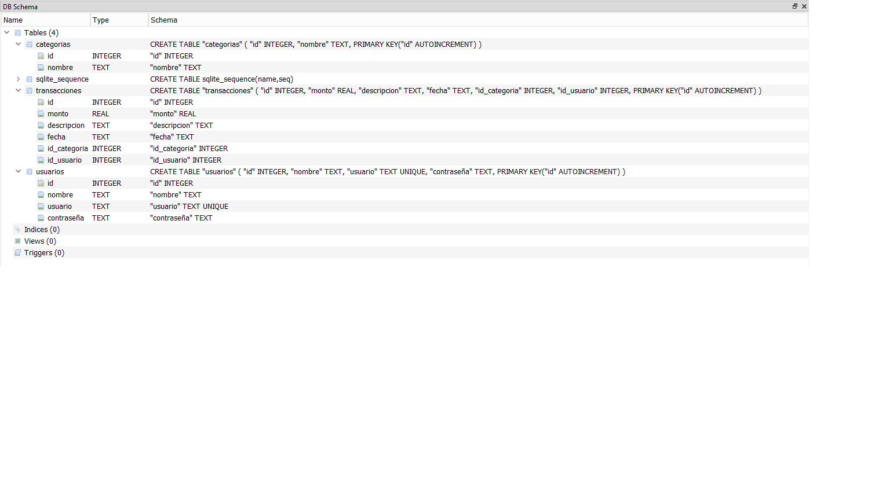
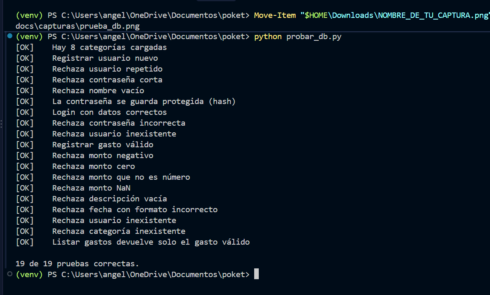

# Informe de diseño y pruebas: Pocket

**Proyecto final de Programación Computacional III (UGB)**
**Equipo:** Los Ponis
**Integrantes y roles:**
- Freddy: base de datos y lógica.
- Dixy: machine learning (sugerencia de categoría).
- Angely Gissel Rivera Sandoval: interfaz en Streamlit y documentación.

**Repositorio:** https://github.com/freddy-hash/pocket

---

## 1. Descripción del sistema

Pocket es una aplicación web de finanzas personales. Permite que cada persona cree su cuenta, inicie sesión y registre sus gastos diarios indicando monto, descripción, fecha y categoría. La aplicación guarda los gastos en una base de datos y le muestra al usuario una lista de sus gastos con el total acumulado y un gráfico de barras con lo gastado en cada categoría.

El sistema incluye un modelo de machine learning que sugiere la categoría a partir de la descripción del gasto (por ejemplo, "bus" se sugiere como *Transporte*). El usuario puede aceptar o cambiar la sugerencia.

**Tecnologías utilizadas:** Python, Streamlit, SQLite, pandas, plotly, scikit-learn y bcrypt.

**Categorías de gasto:** Comida y bebida, Transporte, Servicios basicos, Educación y materiales, Entretenimiento y salidas, Ropa y compras personales, Gastos medicos, Hogar renta y ahorro.

---

## 2. Arquitectura y módulos

El proyecto está organizado en capas. La interfaz nunca accede directamente a la base de datos: siempre pasa por las funciones de la capa de datos.

```
Interfaz (Streamlit)  -->  Lógica y datos (db.py)  -->  SQLite (pocket.db)
        |                         
        +--> Gráficos (graficos.py)
        +--> Machine learning (clasificador.py)
```

| Módulo | Archivo | Responsable | Función |
|---|---|---|---|
| Punto de entrada | `app.py` | Angely | Une las pantallas y decide si se muestra el inicio de sesión o la aplicación. |
| Autenticación (interfaz) | `src/ui/auth_ui.py` | Angely | Formularios de registro e inicio de sesión, manejo de sesión y cierre de sesión. |
| Gastos (interfaz) | `src/ui/gastos_ui.py` | Angely | Formulario para registrar gastos y lista de gastos con total. |
| Gráfico (interfaz) | `src/ui/graficos_ui.py` | Angely | Muestra el gráfico de gastos por categoría. |
| Base de datos y lógica | `src/database/db.py` | Freddy | Conexión a SQLite, registro de usuarios, inicio de sesión, registro y consulta de gastos, validaciones. |
| Análisis y gráficos | `src/analytics/graficos.py` | Freddy | Total por categoría (pandas) y gráfico de barras (plotly). |
| Machine learning | `src/ml/clasificador.py` | Dixy | Sugiere la categoría según la descripción. |
| Pruebas de la base | `probar_db.py` | Freddy | 19 pruebas automáticas sobre una copia temporal de la base de datos. |

### 2.1 Flujo de la interfaz

1. Si no hay sesión iniciada, `app.py` muestra las pestañas **Iniciar sesión** y **Registrarse**.
2. Al iniciar sesión, los datos del usuario (`id`, `nombre`, `usuario`) se guardan en `st.session_state`.
3. Con la sesión activa, `app.py` muestra el formulario de gastos, la lista de gastos y el gráfico.
4. El botón **Cerrar sesión** de la barra lateral borra los datos de la sesión y regresa a la pantalla inicial.

---

## 3. Base de datos

La base de datos es SQLite (`data/pocket.db`) y tiene tres tablas relacionadas. El diagrama está en `docs/diagrama_bd.png`.



| Tabla | Campos |
|---|---|
| `usuarios` | id, nombre, usuario (único), contraseña (hash) |
| `categorias` | id, nombre |
| `transacciones` | id, monto, descripcion, fecha, id_categoria, id_usuario |

Cada transacción pertenece a un usuario y a una categoría mediante llaves foráneas.

---

## 4. Decisiones de diseño

| Decisión | Alternativas | Razón |
|---|---|---|
| **SQLite** como base de datos | MySQL, PostgreSQL | No requiere instalar ni configurar un servidor. La base es un solo archivo (`pocket.db`) que viaja con el proyecto, lo que facilita el trabajo en equipo y la demostración. |
| **bcrypt** para las contraseñas | Guardar texto plano, hash simple (MD5, SHA) | La contraseña nunca se guarda: solo su hash con sal. Si alguien accede a la base, no puede leer las contraseñas. |
| **Streamlit** para la interfaz | Flask, Django, Tkinter | Permite construir una interfaz web usando solo Python, sin HTML ni JavaScript, y se integra directamente con pandas y plotly. |
| **Separación en capas** | Todo en un solo archivo | La interfaz solo llama funciones de `db.py`. Cada integrante trabaja en su capa sin pisar el trabajo de los demás. |
| **`st.session_state`** para la sesión | Variables globales | Streamlit vuelve a ejecutar el script en cada interacción; `session_state` conserva el usuario entre ejecuciones y evita que se mezclen datos entre usuarios. |
| **Mensajes de error de `db.py`** mostrados con `st.error` | Validar también en la interfaz | Las reglas viven en un solo lugar (la capa de datos) y la interfaz solo muestra el mensaje, sin duplicar lógica. |

---

## 5. Validaciones

Las validaciones están en `db.py`. La interfaz muestra el mensaje que devuelve cada función.

### 5.1 Registro de usuario

| Regla | Mensaje |
|---|---|
| Nombre, usuario y contraseña son obligatorios | "Todos los campos son obligatorios." |
| Contraseña de al menos 6 caracteres | "La contraseña debe tener al menos 6 caracteres." |
| Contraseña de máximo 72 bytes (límite de bcrypt) | "La contraseña es demasiado larga." |
| El nombre de usuario debe ser único | "Ese usuario ya existe." |

### 5.2 Inicio de sesión

| Regla | Mensaje |
|---|---|
| Usuario y contraseña no vacíos | "Escribe tu usuario y contraseña." |
| Usuario inexistente o contraseña incorrecta | "Usuario o contraseña incorrectos." (el mismo mensaje en ambos casos, para no revelar si el usuario existe) |

### 5.3 Registro de gasto

| Regla | Mensaje |
|---|---|
| El monto debe ser un número válido | "El monto debe ser un número." / "El monto debe ser un número válido." |
| El monto debe ser mayor que cero | "El monto debe ser mayor que cero." |
| La descripción no puede estar vacía | "La descripción no puede estar vacía." |
| La fecha debe tener formato AAAA-MM-DD | "La fecha debe tener el formato AAAA-MM-DD." |
| El usuario debe existir | "El usuario no existe." |
| La categoría debe existir | "La categoría no existe." |

En la interfaz, el selector de fecha (`st.date_input`) y el selector de categoría (`st.selectbox`) evitan que el usuario escriba valores inválidos en esos dos campos.

---

## 6. Pruebas realizadas

### 6.1 Pruebas automáticas de la base de datos (`probar_db.py`)

Las 19 pruebas corren sobre una **copia temporal** de `pocket.db`, así que no modifican la base de datos real. Para ejecutarlas: `python probar_db.py`.

**Resultado: 19 de 19 pruebas correctas.**

| N.º | Prueba | Resultado |
|---|---|---|
| 1 | Hay 8 categorías cargadas | OK |
| 2 | Registrar usuario nuevo | OK |
| 3 | Rechaza usuario repetido | OK |
| 4 | Rechaza contraseña corta | OK |
| 5 | Rechaza nombre vacío | OK |
| 6 | La contraseña se guarda protegida (hash) | OK |
| 7 | Login con datos correctos | OK |
| 8 | Rechaza contraseña incorrecta | OK |
| 9 | Rechaza usuario inexistente (login) | OK |
| 10 | Registrar gasto válido | OK |
| 11 | Rechaza monto negativo | OK |
| 12 | Rechaza monto cero | OK |
| 13 | Rechaza monto que no es número | OK |
| 14 | Rechaza monto NaN | OK |
| 15 | Rechaza descripción vacía | OK |
| 16 | Rechaza fecha con formato incorrecto | OK |
| 17 | Rechaza usuario inexistente (gasto) | OK |
| 18 | Rechaza categoría inexistente | OK |
| 19 | Listar gastos devuelve solo el gasto válido | OK |



### 6.2 Pruebas del clasificador (Dixy)

*Pendiente: se completará cuando `src/ml/clasificador.py` esté disponible.*

### 6.3 Pruebas manuales de la interfaz

| N.º | Prueba | Resultado esperado | Resultado obtenido |
|---|---|---|---|
| M1 | Registrar un usuario nuevo | Mensaje verde de éxito | Correcto |
| M2 | Iniciar sesión con datos correctos | Mensaje de bienvenida y nombre en la barra lateral | Correcto |
| M3 | Cerrar sesión | Regresa a la pantalla de inicio de sesión | Correcto |
| M4 | Registrar un gasto válido | "Gasto registrado correctamente." | Correcto |
| M5 | Ver la lista de gastos | Total y tabla con el gasto | Correcto |
| M6 | Ver el gráfico por categoría | Barras por categoría con su total | Correcto |
| M7 | Cambiar entre modo claro y oscuro | La interfaz cambia de tema | Correcto |

*Pendiente: agregar capturas de pantalla de cada prueba y probar los casos de error (contraseña corta, usuario repetido, monto cero).*


---

## 7. Instrucciones de instalación y ejecución

**Requisitos:** Python 3 y Git.

1. Clonar el repositorio y entrar a la carpeta:

```
git clone https://github.com/freddy-hash/pocket.git
cd pocket
git checkout desarrollo
```

2. Crear y activar un entorno virtual (Windows PowerShell):

```
python -m venv venv
venv\Scripts\Activate.ps1
```

3. Instalar las dependencias:

```
pip install -r requirements.txt
```

4. Ejecutar la aplicación:

```
streamlit run app.py
```

5. Abrir en el navegador la dirección que muestra la terminal (normalmente `http://localhost:8501`).

**Pruebas de la base de datos:** `python probar_db.py`